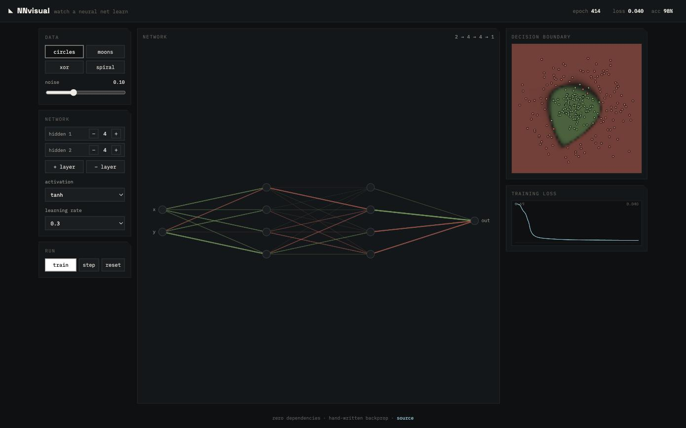

# NNvisual

Pick a neural network — **transformer**, **CNN**, **MLP**, or **diffusion** — and
watch the real thing run in your browser. Nothing on any page is a canned
animation: every activation, attention weight, gradient, and denoising step is
computed live by models running in vanilla JavaScript.

**Live:** [j4den.com/nnvisual](https://j4den.com/nnvisual/)



## The four demos

- **Simple classification — `mlp.html`.** Draw a digit; a pretrained
  784-32-16-10 perceptron classifies it live. The 28×28 unrolls into its 784
  input values, activations light the layer columns, and hovering a first-layer
  neuron shows its weights as an image — what it looks for. Then train it
  yourself: real minibatch SGD on 6,000 MNIST images in-page, an editable
  architecture, a measured gradient-descent loss curve along the actual
  gradient, a backprop replay of real gradients — or teach it *your*
  handwriting from a dataset you draw yourself.
- **Image detection — `cnn.html`.** A 97%-test-accuracy convnet, stage by
  stage: learned kernels, live feature maps, pooling, flatten, vote. Scan mode
  runs the convolution in slow motion with the patch × kernel arithmetic; a
  kernel playground lets you convolve your drawing with hand-edited kernels.
- **Language models — `transformer.html`.** A 115k-parameter char-GPT trained
  on Shakespeare generates text token by token. Attention arcs and the causal
  QK^T triangle are clickable down to single scores; the 65 character
  embeddings are PCA-projected live (vowels, capitals, digits visibly
  cluster), and a cosine-similarity explorer draws the true 64-d angle
  between any two characters.
- **Image generation — `diffusion.html`.** Slide t to noise a real digit by
  the exact schedule math, then watch class-conditional DDIM grow a new digit
  out of pure noise — the model's clean-image belief and predicted noise at
  every step, with classifier-free guidance you control. The latent tab
  encodes 1,000 digits through a 2-D autoencoder bottleneck into a plane you
  can drag to decode.
  Sampling is deterministic, so **copy link** shares a URL
  (`#digit=5&seed=12&steps=15&guidance=2`) that regrows the exact same digit.

## Small things that make it nicer

- **Light and dark.** The sun/moon button in the top bar switches; the choice
  is saved as `localStorage.theme` (the same key the rest of j4den.com uses)
  and with nothing saved the page follows the device. Every canvas reads the
  CSS tokens at draw time, so the digit pads, heatmaps, charts, attention
  matrix and latent plane repaint in the new palette. `js/theme-boot.js`
  runs in `<head>` so there is no flash of the wrong theme.
- **Shareable links** on every demo, not just diffusion. The MLP page carries
  its layers, learning rate and batch size (`#layers=24,12&lr=0.05&batch=64`
  — fresh nets and the epoch shuffle are seeded, so two people opening the
  same link and pressing *1 epoch* get the same loss curve); the CNN page
  carries the playground kernel, normalize, the scan kernel and the pre-relu
  view; the transformer page carries prompt, temperature, top-k, top-p,
  greedy, the sampling seed and how many tokens to regrow, so
  `#prompt=JULIET%3A&temp=1.2&topk=5&seed=42&n=30` reproduces the exact text.
- **Compare two training runs.** *Pin this run* keeps the loss and accuracy
  curves on the MLP charts as a quiet line while you change the learning rate
  or the layers and train again.
- **1 batch** on the MLP page does a single minibatch of SGD and then replays
  that batch's real backward pass through the diagram.
- **Export png** downloads the 28×28 the network sees, in MNIST's own
  convention (white ink on black), ready to feed into your own model.
- **Keyboard shortcuts** on every demo (listed next to the buttons): train,
  step, generate, scan and reset without reaching for the mouse. They stay
  quiet while you are typing in a field.

Every page works at phone width with touch drawing, and the clickable
canvases (sample digits, feature maps, the attention matrix, the denoising
film, the latent plane) are reachable and operable from the keyboard.

## How it's built

- **Zero runtime dependencies.** `public/js/engine/` is a small Float32Array
  engine: dense nets with backward, conv/pool, a transformer forward with full
  capture, and a DDIM sampler. No frameworks, no build step. The only dev
  dependency is ESLint.
- **Models are trained offline, reproducibly** by the numpy scripts in
  `training/` (each gradient-checks itself before running), then shipped as
  fp16 binaries in `public/data/weights/` with stratified MNIST subsets. The
  MNIST subsets are mostly zeros, so they also ship gzipped (`npm run
  data:gzip`, a fifth of the bytes) and the browser inflates them itself;
  each page preloads its data and modules so the fetches start with the HTML.
- **CI proves the site tells the truth.** `tests/` holds 69 tests: numerical
  gradient checks, a conv reference implementation, transformer causality —
  and golden-fixture gates where the JS engine must reproduce the numpy
  trainers' outputs, clear accuracy thresholds on held-out digits, and
  generate diffusion samples the shipped CNN recognizes. The gzipped data is
  pinned byte-for-byte to the plain files, and the link parser and theme
  tokens have their own tests.

```sh
npm run serve   # http://localhost:4173 — any static server works
npm test        # node --test
npm run lint
```

## Repo layout

```
public/           the deployable site (static, self-contained)
  js/engine/      the math: tensor ops, mlp, conv, transformer, diffusion
  js/pages/       one controller per demo
  js/ui/          draw box, heatmaps, bars, charts, theme tokens, links, keys
  data/           mnist subsets + fp16 model weights
training/         numpy trainers + dataset packer (python3 + numpy only)
tests/            engine tests + golden gates pinning JS to the trainers
docs/PLAN.md      the build plan and per-demo visualization specs
```

## Deploying

`public/` is copied into the j4den.com site repo at `frontend/public/nnvisual/`
(`scripts/sync-to-site.sh`), where Cloudflare Pages serves it. Every page ships
a strict same-origin CSP meta tag and works standalone.

Work lands through pull requests with required CI — see
[CONTRIBUTING.md](CONTRIBUTING.md) and [SECURITY.md](SECURITY.md).

## License

[MIT](LICENSE)
